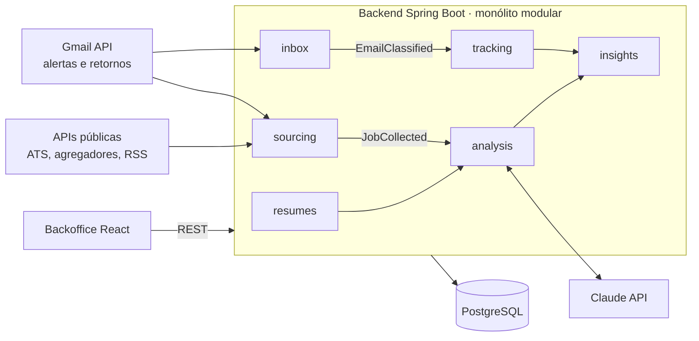

# Job Hunter Agent — Documento de Arquitetura

22/10/2026 · Gabriel Laranja

> **Nota de implementação (23/10/2026):** o projeto usa **Java 25 e Spring Boot 4.1** (com Spring Modulith 2.1), e não Java 21 e Spring Boot 3 como na primeira versão deste documento. As demais decisões tomadas na implementação estão na seção [Decisões de implementação](#decisões-de-implementação), no fim.

## Visão geral

O Job Hunter Agent é um sistema pessoal que coleta vagas todos os dias, mede a aderência de cada uma ao seu perfil, acompanha suas candidaturas num kanban e transforma os requisitos do mercado em sugestões concretas para o currículo. Ele também é um projeto de portfólio: Java 25, Spring Boot, mensageria, integração com LLM e frontend moderno, tudo num repositório público.

**Objetivos**

- Coletar diariamente vagas que casam com palavras-chave configuráveis, de forma automática.
- Ler o Gmail para captar alertas de vagas e respostas de recrutadores, atualizando o status das candidaturas.
- Resumir os requisitos de cada vaga e agregar tendências (stacks, senioridade, modelo de trabalho).
- Sugerir ajustes no currículo e no LinkedIn com base nas lacunas mais frequentes.
- Oferecer um backoffice web para acompanhar o funil (Nova → Interesse → Aplicada → Entrevista → Oferta / Recusada), dar feedback sobre as vagas, classificar os retornos, registrar qual currículo foi enviado a cada empresa e fazer upload das versões do currículo.
- Guardar o link e a descrição completa de cada vaga aplicada, mesmo depois que ela sair do ar.
- Cadastrar e monitorar as empresas das vagas (volume, frequência e tipo de vagas, sinais de contratação) e classificá-las pelo selo GPTW, verificado na internet.
- Organizar as empresas por nichos com fit ao seu perfil, começando por fintechs, bancos e instituições financeiras, seguidos de consultorias de tecnologia; novos nichos entram por cadastro.

**Não-objetivos**

- Scraping do LinkedIn ou de qualquer site que proíba isso nos termos de uso.
- Candidatura automática: o envio continua manual, feito por você.
- Multiusuário no MVP: é um sistema de um usuário só, com autenticação simples.

**Princípios**

- Ports & Adapters: cada fonte de vagas é um adapter plugável atrás de uma interface `JobSource`.
- Tudo idempotente: rodar a coleta duas vezes não duplica vagas.
- IA como enriquecimento, não como dependência: se a API do LLM falhar, a vaga é salva e reprocessada depois.

## Arquitetura de alto nível

Um backend Spring Boot recebe vagas do Gmail e de APIs públicas, enriquece cada uma com a Claude API e expõe tudo ao backoffice via REST. Os módulos conversam por eventos de domínio dentro do mesmo processo.



O fluxo principal vai das fontes para `sourcing`, que publica `JobCollected` para `analysis`; os e-mails de retorno seguem por `inbox` até `tracking`, que move a candidatura no kanban.

## Fontes de vagas e estratégia de coleta

A fonte principal são os alertas de vaga recebidos por e-mail: você cadastra as palavras-chave em cada plataforma, ela envia os alertas e o agente lê o Gmail. Isso cobre o LinkedIn sem violar os termos de uso e sem risco para a sua conta. As APIs públicas entram como complemento.

| Fonte | Como coletar | Observação |
| --- | --- | --- |
| LinkedIn | Alertas de vaga por e-mail → Gmail API | Um alerta por combinação de palavra-chave e localidade |
| Gupy | Alertas por e-mail; páginas públicas de vagas das empresas | Forte no mercado brasileiro |
| Indeed / Glassdoor | Alertas por e-mail | O parser de cada remetente é diferente |
| Greenhouse / Lever | APIs públicas de job board por empresa | Você mantém uma lista de empresas-alvo |
| Remotive, Adzuna e similares | APIs REST públicas | Bom para vagas remotas e internacionais |

**Como funciona a coleta**

1. O `JobSearchProfile` guarda suas palavras-chave ("Java", "Spring Boot", "Sênior", "Remoto"), as exclusões ("PHP", "estágio") e as localidades.
2. Um job agendado (por exemplo às 7h) chama cada `JobSource`, que devolve uma lista de `RawJob`.
3. A normalização gera um `fingerprint` = hash(empresa + título normalizado + localidade) e descarta duplicatas.
4. Vagas novas vão para a fila de enriquecimento por IA.

As regras de uso e a disponibilidade das APIs mudam com frequência: confira os termos de cada uma antes de integrar. Comece só pelo Gmail; as APIs vêm depois.

**Fontes complementares aos alertas**

O e-mail cobre o LinkedIn com segurança, mas chega atrasado e com descrições cortadas. Estas fontes ampliam a cobertura e trazem a descrição completa da vaga.

| Fonte | Como integrar | Por que vale |
| --- | --- | --- |
| ATS das empresas-alvo (Greenhouse, Lever, Ashby, Workable, SmartRecruiters) | Endpoints públicos de job board, consultados por slug da empresa | Vaga direto na origem, muitas vezes antes de chegar ao LinkedIn, com descrição completa |
| Páginas de carreira na Gupy | Página pública de vagas de cada empresa, consultada por uma lista de empresas | Cobre bancos, varejo e fintechs brasileiras que não usam ATS internacional |
| Repositórios de vagas no GitHub (ex.: backend-br/vagas) | GitHub API, lendo issues abertas e filtrando por label (Java, Sênior, Remoto) | Vagas brasileiras de backend, estruturadas e gratuitas |
| Agregadores via API (JSearch, que agrega o Google for Jobs; Adzuna; Jooble) | API REST com chave; planos gratuitos limitados | Uma consulta traz vagas de dezenas de sites |
| Feeds RSS de sites remotos (Remotive, We Work Remotely) | Leitura de RSS com Rome ou similar | Vagas remotas e internacionais, em USD |
| Busca de vagas no LinkedIn por URL salva | Você abre um link de busca já filtrado (ex.: últimas 24h); o sistema só gera e guarda os links | Mais fresco que o alerta, sem automação na sua conta |

**Lista de empresas-alvo.** A melhor melhoria de busca é inverter a lógica: além de procurar vagas, monitore 30 a 50 empresas onde você quer trabalhar. Guarde em `company (watch_status = ALVO)` o nome, o ATS usado e o slug, e o coletor consulta cada uma diariamente. Isso usa a mesma tabela do monitoramento de empresas, mais um adapter por ATS, e os formatos se repetem muito.

**Evite:** automação de navegador logada no LinkedIn, bots que pedem sua senha e scraping de sites que proíbem isso. O ganho é pequeno perto do risco de bloqueio da conta.

## Modelo de dados (PostgreSQL)

São dez tabelas no núcleo; as de empresas, selos e nichos estão nas seções próprias, mais adiante. A `job` é o centro do modelo: tudo o que vem de fora vira uma vaga, e a candidatura é uma camada separada sobre ela, com histórico de status. As migrações ficam no Flyway.

| Tabela | Campos principais | Papel |
| --- | --- | --- |
| `search_profile` | id, name, keywords[], excluded_keywords[], locations[], remote_only, active | Suas buscas configuráveis |
| `job` | id, source, external_id, fingerprint (unique), title, company, location, work_model, salary_range, url, raw_description, collected_at | A vaga normalizada |
| `job_analysis` | job_id, seniority, required_skills jsonb, nice_to_have jsonb, summary, match_score (0–100), gaps jsonb, model_version, analyzed_at | Enriquecimento por IA |
| `job_feedback` | id, job_id, rating (GOSTEI, NEUTRO, NAO_GOSTEI), reasons[] (salário, stack, senioridade, modelo de trabalho, empresa, localização), comment, created_at | Seu feedback sobre a vaga; calibra o score |
| `application` | id, job_id, status, applied_at, channel (Easy Apply, site da empresa, indicação, e-mail), resume_version_id, notes, next_action_at | A candidatura e o currículo enviado |
| `job_snapshot` | id, application_id (unique), job_url, link_status (ATIVO, REMOVIDO, NAO_VERIFICADO), link_checked_at, title, company, description_md, capture_source (COLETA, EXTENSAO, MANUAL), page_pdf_key, captured_at | Cópia congelada da vaga no momento em que você aplicou: link e descrição completa |
| `application_event` | id, application_id, from_status, to_status, response_type, origin (MANUAL, EMAIL, SISTEMA), email_message_id, note, created_at | Histórico do funil, incluindo cada retorno |
| `email_message` | id, gmail_id (unique), thread_id, application_id, sender, subject, received_at, ai_classification, ai_confidence, final_classification, classified_by (IA, USUARIO), processed | E-mails lidos; a palavra final na classificação é sua |
| `resume_version` | id, label, target_role, file_key, file_name, content_type, size_bytes, sha256, extracted_text, skills jsonb, is_default, archived, created_at | Arquivos de currículo enviados pelo upload |
| `insight_report` | id, period_start, period_end, top_skills jsonb, gaps jsonb, recommendations text | Relatório semanal de tendências |

Decisões de modelagem:

- `status` é um enum: NOVA, INTERESSE, APLICADA, TRIAGEM, ENTREVISTA, TESTE_TECNICO, OFERTA, RECUSADA, DESISTI.
- `response_type` (o tipo de retorno) é outro enum: CONVITE_ENTREVISTA, TESTE_TECNICO, PEDIDO_INFORMACAO, OFERTA, RECUSA, OUTRO. A IA sugere, você confirma ou corrige, e a correção grava `classified_by = USUARIO`.
- Retornos que não chegam por e-mail (WhatsApp, mensagem no LinkedIn, ligação) são registrados manualmente como `application_event` com `origin = MANUAL` e o mesmo `response_type`. Assim o funil conta todos os retornos, não só os do Gmail.
- Ao mover um card para APLICADA, o backoffice exige escolher a versão do currículo. Você sabe exatamente o que cada empresa recebeu e mede a conversão por versão.
- Ao aplicar, o sistema cria o `job_snapshot` copiando o link e a descrição da `job`. A cópia é congelada: as vagas costumam sair do ar antes da entrevista, e você precisa saber exatamente o que foi pedido. Para vagas cadastradas à mão, você cola o link e a descrição no próprio formulário. Opcionalmente, um PDF da página é salvo no storage (`page_pdf_key`).
- Um job semanal verifica os links das candidaturas abertas (requisição HEAD com o `RestClient`) e marca `link_status = REMOVIDO` quando a vaga sai do ar. Se a vaga foi removida e você não teve retorno, é provável que a posição tenha sido preenchida.
- Os arquivos de currículo ficam fora do banco, em storage de objetos (MinIO local, S3 ou Cloudflare R2 em produção). O banco guarda metadados, o `sha256` (evita upload duplicado) e o texto extraído para a IA.
- As skills ficam em `jsonb`, com índice GIN, para permitir consultas como "vagas que pedem Kafka" sem um modelo relacional pesado.
- A `job_analysis` guarda `model_version`, para você reprocessar vagas quando trocar o prompt.
- A `application_event` é append-only: o kanban mostra o estado atual, mas as métricas de conversão saem daqui.

## Camada de IA

A IA faz quatro tarefas, cada uma com prompt próprio e saída em JSON validado por schema. O resto é código determinístico.

| Tarefa | Entrada | Saída (JSON) | Quando roda |
| --- | --- | --- | --- |
| Extração de requisitos | Descrição bruta da vaga | seniority, required_skills, nice_to_have, work_model, summary (3 linhas) | A cada vaga nova |
| Score de aderência | Requisitos + currículo ativo | match_score, matched_skills, gaps, justificativa curta | Logo após a extração |
| Classificação de e-mails | Remetente, assunto, corpo | ai_classification (ALERTA_VAGA ou um response_type), empresa, vaga provável, confidence | A cada e-mail novo |
| Insights do currículo | Agregados da semana + currículo | top 5 lacunas, bullets reescritos, palavras-chave para o LinkedIn | Semanal |

**Score híbrido.** Calcule primeiro um score determinístico (a interseção entre suas skills e as obrigatórias, com pesos) e use o LLM só para ajustar e justificar. Assim o score é explicável e não oscila entre execuções.

**Exemplo de prompt de extração (resumido)**

```text
Você é um analista de vagas de tecnologia. A partir da descrição abaixo, retorne SOMENTE um JSON
no schema: {seniority, required_skills[], nice_to_have[], work_model, summary}.
Normalize nomes de tecnologia ("springboot" -> "Spring Boot"). Não invente requisitos.
Descrição: {{raw_description}}
```

**Regras de uso**

- Use o SDK oficial da Anthropic para Java para chamar a API do Claude; envie o currículo como bloco de sistema com prompt caching, já que ele se repete em todas as chamadas.
- E-mails com classificação abaixo de 0,7 de confiança vão para uma fila de revisão manual no backoffice, sem mudar o status sozinhos.
- Nunca mande a caixa de entrada inteira ao LLM: filtre antes por remetente ou label do Gmail (por exemplo, a label `jobs`).

**Ciclo de feedback.** O seu feedback é o que torna o agente melhor com o tempo:

- **Feedback das vagas:** os motivos de NAO_GOSTEI mais frequentes viram filtros sugeridos (por exemplo, "5 vagas descartadas por salário abaixo da faixa" leva a sugerir um piso salarial). As vagas marcadas GOSTEI e NAO_GOSTEI entram no prompt de score como exemplos de preferência.
- **Correções de classificação:** cada e-mail que você reclassifica vira um exemplo no prompt de classificação, e o painel mostra a taxa de acerto da IA ao longo do tempo.
- **Currículo por candidatura:** o relatório semanal compara a conversão Aplicada → Entrevista de cada versão do currículo e indica qual funciona melhor para cada tipo de vaga.
- **Texto extraído do upload:** o arquivo enviado passa pelo Apache Tika (PDF e DOCX), e o texto alimenta o score e as sugestões. Sempre que você sobe uma versão nova, as vagas abertas são repontuadas.

## Backend Spring Boot

Comece com um monólito modular (Spring Modulith) em Java 25 e Spring Boot 4.1. Os módulos já ficam isolados, e dá para extraí-los como microsserviços depois, se fizer sentido para o portfólio.

```text
jobhunter/
├── sourcing/      # JobSource (port), adapters: GmailAlertSource, GreenhouseSource, GupySource...
│                  # CollectJobsScheduler, deduplicação por fingerprint
├── jobs/          # Job, JobFeedback, fingerprint, catálogo de vagas (ver Decisões de implementação)
├── analysis/      # JobAnalyzer, MatchScorer, prompts/
├── tracking/      # Application, ApplicationEvent, JobSnapshot, máquina de estados do status
├── inbox/         # GmailClient (OAuth2), EmailClassifier, StatusUpdater
├── resumes/       # upload (MinIO/S3), extração de texto (Tika), versões do currículo
├── companies/     # Company, aliases e merge, métricas semanais
├── niches/        # Niche, NicheSegment, CompanyFitCalculator, CompanySeedSource (Bacen, CNPJ)
├── recognition/   # RecognitionSearchClient (busca web), selo GPTW, fila de revisão
├── insights/      # WeeklyInsightJob, ResumeAdvisor
├── profile/       # SearchProfile
└── shared/        # eventos de domínio, config, segurança, LlmClient, LinkVerifier
```

**Comunicação entre módulos por eventos de domínio** (`ApplicationEventPublisher` + `@ApplicationModuleListener`): `JobCollected` → análise; `JobAnalyzed` → notificação, se o score for ≥ 75; `EmailClassified` → atualização de status; `CompanyDiscovered` → classificação de nicho e busca do selo GPTW. Isso dispensa uma fila externa no MVP; o Kafka ou o RabbitMQ entram depois, se você quiser mostrar mensageria.

**Endpoints REST**

| Método | Rota | Uso |
| --- | --- | --- |
| GET | `/api/jobs?minScore=&status=&rating=&q=&page=` | Lista paginada com filtros |
| GET | `/api/jobs/{id}` | Detalhe da vaga, análise e feedback |
| PUT | `/api/jobs/{id}/feedback` | Grava ou atualiza o feedback (rating, motivos, comentário) |
| POST | `/api/jobs/{id}/application` | Marca interesse ou aplicação; `resumeVersionId` é obrigatório para APLICADA |
| PATCH | `/api/applications/{id}/status` | Move o card no kanban |
| PATCH | `/api/applications/{id}/resume` | Corrige o currículo registrado na candidatura |
| GET | `/api/applications/{id}/snapshot` | Link, status do link e descrição salva da vaga aplicada |
| PUT | `/api/applications/{id}/snapshot` | Cola ou corrige o link e a descrição (vagas manuais) |
| GET | `/api/applications?status=&q=` | Lista das candidaturas com link e trecho da descrição; busca no texto salvo |
| POST | `/api/applications/{id}/responses` | Registra um retorno manual (tipo, canal, nota) |
| GET | `/api/applications/board` | Dados do kanban agrupados por status |
| GET | `/api/emails?classification=&reviewed=` | E-mails lidos, com a classificação da IA |
| PATCH | `/api/emails/{id}/classification` | Confirma ou corrige a classificação e a candidatura ligada |
| POST | `/api/resumes` (multipart) | Upload de currículo (PDF ou DOCX, até 5 MB) |
| GET | `/api/resumes` · `/api/resumes/{id}/file` | Lista as versões e baixa o arquivo (URL pré-assinada) |
| PATCH | `/api/resumes/{id}` | Renomeia, define como padrão ou arquiva |
| GET/POST/PUT | `/api/search-profiles` | CRUD das buscas |
| GET | `/api/insights/latest` | Último relatório semanal |
| POST | `/api/admin/collect` | Dispara a coleta manualmente |

**Bibliotecas:** Spring Web MVC, Data JPA, Flyway, Spring Security (login único, ou OAuth2 com Google), Resilience4j ou o retry nativo do Spring Framework 7 nas APIs externas, ShedLock (garante um único scheduler rodando), Testcontainers e WireMock nos testes, springdoc-openapi para a documentação.

## Frontend backoffice

Use React com Vite e TypeScript, TanStack Query para os dados, shadcn/ui para os componentes, dnd-kit para o kanban e Recharts para os gráficos. Um SPA simples basta; o Next.js só compensa se você quiser SSR.

| Tela | O que mostra | Ações |
| --- | --- | --- |
| Caixa de vagas | Vagas novas ordenadas por score, com resumo de 3 linhas e chips de skills (verde = você tem, vermelho = lacuna) | Gostei, Neutro e Não gostei com motivos rápidos; Tenho interesse; Abrir vaga |
| Kanban | Colunas por status, com empresa, cargo, dias no status, versão do currículo enviada e próxima ação em cada card | Arrastar entre colunas (ao soltar em Aplicada, abre o seletor de currículo), anotar, agendar follow-up |
| Detalhe da vaga | Descrição, análise da IA, gaps, seu feedback, currículo enviado, linha do tempo de eventos e retornos | Registrar retorno manual, trocar o currículo registrado, editar notas |
| Retornos | Todos os e-mails e retornos manuais, com a classificação da IA e a confiança; os de baixa confiança aparecem primeiro | Confirmar ou corrigir o tipo de retorno, ligar a uma candidatura, marcar como irrelevante |
| Currículos | Versões enviadas, com rótulo, cargo-alvo, data, número de candidaturas e taxa de entrevistas de cada uma | Upload por arrastar e soltar, pré-visualizar o PDF, definir padrão, arquivar |
| Insights | Skills mais pedidas nas últimas 4 semanas, lacunas, funil de conversão, desempenho por versão de currículo e acerto da IA | Gerar sugestões de currículo |
| Minhas candidaturas | Todas as vagas aplicadas com link, status do link, data, status e currículo enviado | Buscar nas descrições salvas, abrir o AppliedJobCard |
| Empresas | Vagas ativas e dos últimos 90 dias, frequência, tempo médio no ar, selo GPTW, tipo (contratante, consultoria de TI, recrutamento) | Mudar status (monitorada, alvo, ignorada), mesclar duplicatas, revisar selos |
| Nichos | Financeiro e Consultorias: empresas por fit, subsegmento e justificativa, com mapa por subsegmento | Filtrar (GPTW, vaga aberta, nunca apliquei), marcar como alvo, editar pesos |
| Configurações | Perfis de busca, palavras-chave, empresas-alvo | CRUD |

**Componente `AppliedJobCard` (vaga aplicada).** Aparece no detalhe da vaga, no painel lateral do kanban e na tela Minhas candidaturas:

- **Link da vaga** em destaque, abrindo em nova aba, com um selo de status (Ativo, Removido, Não verificado) e a data da última verificação.
- **Descrição salva**, renderizada em Markdown, com as skills da análise destacadas e um botão de expandir ou recolher. Se a vaga original saiu do ar, um aviso indica que você está vendo a cópia salva na data da aplicação.
- **Metadados:** empresa, cargo, data da aplicação, canal e versão do currículo enviada (com link para baixar o arquivo).
- **Ações:** copiar o link, baixar o PDF da página (se existir), editar a descrição e preparar para a entrevista.

**Tela Minhas candidaturas.** Uma tabela com todas as vagas aplicadas: empresa, cargo, data, status, link clicável e currículo enviado. A busca percorre também as descrições salvas, o que permite, por exemplo, encontrar todas as vagas em que você aplicou que pediam Kafka.

A métrica que mais importa no painel é a conversão Aplicada → Entrevista. Se ela estiver baixa, o problema é o currículo ou o filtro de vagas, e o relatório de insights deve dizer qual dos dois.

## Segurança, custos e infraestrutura

O maior risco do projeto é o acesso ao seu Gmail; o resto é barato e simples.

**Segurança**

- Gmail com OAuth2 e escopo `gmail.readonly` (ou `gmail.modify`, só se for aplicar labels). Guarde o refresh token criptografado, nunca no repositório.
- Filtre no Gmail antes de ler: crie a label `jobs` com filtros automáticos para LinkedIn, Gupy e recrutadores, e leia só essa label.
- O backoffice fica atrás de login, mesmo sendo só para você. Exponha a aplicação com HTTPS (Cloudflare Tunnel resolve sem abrir portas).
- Repositório público com `.env.example`; os segredos ficam nas variáveis de ambiente e nos secrets do GitHub Actions.

**Infraestrutura**

- Local: `docker-compose` com app, Postgres e frontend.
- Deploy: uma VPS pequena ou o free tier do Fly.io / Railway, com Postgres gerenciado (Neon ou Supabase).
- CI/CD: GitHub Actions com build, testes (Testcontainers) e imagem Docker.
- Observabilidade: Actuator + Micrometer, com logs estruturados. O suficiente para mostrar boas práticas sem montar um Dynatrace.

**Upload de currículos.** Valide o tipo pelo conteúdo, e não pela extensão (o Tika detecta isso); limite o tamanho a 5 MB; gere o nome do arquivo no servidor; e sirva o download por URL pré-assinada de curta duração. Os currículos têm seus dados pessoais, então o bucket é privado.

**Custos.** O custo variável é a API do LLM. Com algumas dezenas de vagas e e-mails por dia, prompt caching do currículo e um modelo menor (Haiku) para extração e classificação, a conta tende a ficar baixa. Use um modelo maior apenas no relatório semanal. Coloque um limite de gasto mensal na conta da API desde o primeiro dia.

**Dados públicos e LGPD.** A base do CNPJ traz nomes e dados parciais dos sócios. Importe só os campos da empresa (CNPJ, razão social, CNAE, porte, cidade) e descarte os dados de pessoas físicas. Vale o mesmo para contatos de recrutadores: guarde só o necessário para o follow-up.

**Custos da busca na web.** A API usada no selo GPTW e na descoberta de fintechs e consultorias cobra por consulta. Com cache de 6 meses e buscas só para empresas novas ou com vagas ativas, o volume mensal fica baixo, mas configure um limite de gasto nela também.

## Monitoramento de empresas

Toda empresa que aparece numa vaga é cadastrada automaticamente, e o sistema passa a acompanhar quantas vagas ela publica, com que frequência, de que tipo e quanto tempo cada uma fica no ar. Com alguns meses de dados, isso responde perguntas como: quais empresas estão contratando Java sênior agora, quem reabre a mesma vaga toda hora e quem fecha rápido.

**Cadastro automático e deduplicação**

1. Na coleta, o nome da empresa é normalizado (sem "Ltda", "S.A.", "Brasil", acentos e caixa) e comparado com `company.normalized_name` e `company_alias`.
2. Sem correspondência, a empresa é criada com status `DESCOBERTA`. Na tela de Empresas, você pode mesclar duplicatas ("Itaú" e "Itaú Unibanco"), e a mescla vira um alias.
3. A IA preenche, quando a descrição permitir, o setor, o porte e se a vaga é da própria empresa, de uma consultoria de tecnologia (que aloca profissionais em clientes) ou de uma agência de recrutamento. Vagas de agência são separadas, para não distorcer os números da empresa contratante; as consultorias de TI têm um nicho próprio (abaixo).

**Modelo de dados**

| Tabela | Campos principais | Papel |
| --- | --- | --- |
| `company` | id, name, normalized_name (unique), website, linkedin_url, sector, size_range, hq_location, ats_type, ats_slug, kind (CONTRATANTE, CONSULTORIA_TI, RECRUTAMENTO), watch_status (DESCOBERTA, MONITORADA, ALVO, IGNORADA), notes, first_seen_at | Cadastro da empresa |
| `company_alias` | id, company_id, alias | Nomes alternativos para a deduplicação |
| `job` (alteração) | + company_id, + first_seen_at, + last_seen_at, + closed_at, + repost_of_job_id | Liga a vaga à empresa e registra o ciclo de vida |
| `company_metrics_weekly` | company_id, week_start, jobs_opened, jobs_closed, jobs_active, reposts, avg_days_open, by_seniority jsonb, by_area jsonb, by_work_model jsonb, top_skills jsonb | Série semanal pré-calculada para os gráficos |

**Métricas acompanhadas**

| Métrica | Como é calculada | O que indica |
| --- | --- | --- |
| Volume de vagas | Vagas novas por semana e por mês | Se a empresa está em expansão ou parada |
| Frequência de abertura | Intervalo médio entre vagas novas; dias desde a última | Ritmo de contratação e o melhor momento para ficar de olho |
| Tipo de vaga | Distribuição por senioridade, área (backend, dados, front), stack e modelo de trabalho | Se ela contrata o seu perfil e se o remoto é real |
| Tempo no ar | `closed_at − first_seen_at`, a partir da verificação diária dos links | Fechamento rápido sugere contratação; vaga parada por meses sugere vaga "fantasma" |
| Republicação | Mesma vaga (fingerprint semelhante) reaberta em até 90 dias | Dificuldade de preencher, alta rotatividade ou vaga perpétua |
| Seus resultados | Candidaturas, retornos e entrevistas suas nessa empresa | Se vale continuar aplicando ali |

**Sinais de contratação.** Não há como saber com certeza se uma empresa contratou: o sistema só enxerga vagas abrindo e fechando. O indicador combina sinais indiretos: vagas que fecham rápido sem republicação, aumento do volume ao longo de semanas e retornos recebidos por você. Opcionalmente, você registra à mão o número de funcionários mostrado no LinkedIn uma vez por mês (`headcount` em `company_metrics_weekly`) para ver a tendência. Trate o resultado como estimativa, e não como fato.

**Como a coleta alimenta isso.** Os alertas por e-mail mostram só uma fração das vagas de cada empresa. Para as empresas marcadas como `MONITORADA` ou `ALVO`, o coletor consulta diariamente o ATS público (Greenhouse, Lever, Gupy), que lista todas as vagas abertas. Assim os números ficam completos, e uma vaga que some da lista é marcada como fechada.

**Telas no backoffice**

- **Empresas:** tabela com vagas ativas, vagas nos últimos 90 dias, dias desde a última vaga, tempo médio no ar, selo de consultoria e status de monitoramento, com filtros por setor e stack.
- **Detalhe da empresa:** gráfico de vagas abertas e fechadas por semana, distribuição por senioridade e área, skills mais pedidas, linha do tempo das vagas (com as reposts ligadas), suas candidaturas ali e notas.
- **Alertas:** "empresa ALVO abriu vaga Java sênior", "empresa voltou a contratar depois de 60 dias parada", "volume caiu 50% no trimestre".

**Endpoints:** `GET /api/companies?sort=&sector=&watch=`, `GET /api/companies/{id}`, `GET /api/companies/{id}/metrics?from=&to=`, `PATCH /api/companies/{id}` (status, ATS, notas) e `POST /api/companies/{id}/merge`. Um job semanal (domingo à noite) recalcula `company_metrics_weekly`; o histórico fica a partir do primeiro dia de coleta, por isso vale ligar a coleta cedo, mesmo antes da IA.

### Classificação de boas empresas: selo GPTW

Cada empresa cadastrada recebe um selo GPTW verificado na internet, com o nível de reconhecimento, o ano e o link da evidência. O selo entra no score da vaga e vira filtro no backoffice.

**Níveis.** O GPTW tem dois degraus diferentes, e o sistema distingue os dois. A [Certificação](https://www.publishnews.com.br/materias/2026/06/26/as-melhores-empresas-para-trabalhar-mercado-editorial-saiba-como-participar-do-ranking) já é aberta a empresas com 10 ou mais funcionários; para entrar num ranking, a empresa precisa ter 30 ou mais e passar também pela avaliação das práticas de gestão de pessoas. No Brasil há [cerca de 40 rankings por ano](https://medmais.com/pela-quarta-vez-grupo-medmais-recebe-premio-gptw), entre nacionais, regionais, estaduais, setoriais e temáticos. Para você, o mais relevante é o GPTW TI: na [edição de 2025](https://www.serasaexperian.com.br/carreiras/blog-carreiras/gptw-ti-2025-serasa-experian/), 791 empresas se inscreveram e 140 foram premiadas.

| Selo | Critério | Peso sugerido no score |
| --- | --- | --- |
| `RANKING_TI` | Premiada no ranking GPTW TI no ano atual ou no anterior | +10 |
| `RANKING` | Premiada em outro ranking GPTW (nacional, estadual, setorial, temático, América Latina) | +7 |
| `CERTIFICADA` | Certificação GPTW válida, sem ranking | +4 |
| `EXPIRADA` | Já foi certificada, mas não renovou | 0 (mostrado como histórico) |
| `NAO_ENCONTRADA` | Busca sem evidência | 0 |

**Como a busca funciona**

1. **Gatilho:** quando uma empresa é cadastrada e, depois, uma vez por mês para as empresas com vagas ativas. O resultado fica em cache por 6 meses (certificações duram cerca de um ano).
2. **Busca na web:** um `RecognitionSearchClient` consulta uma API de busca (Brave Search, Serper ou Tavily) com as variações do nome: `"<empresa>" GPTW certificação`, `"<empresa>" "Great Place to Work" ranking <ano>`. A página oficial de certificação da empresa no site do GPTW tem prioridade sobre notícias e posts da própria empresa.
3. **Verificação por IA:** o LLM lê os trechos e devolve JSON com nível, ano, nome do ranking, posição (se houver), URL da evidência e confiança. A regra no prompt é não inferir: sem menção explícita à empresa e ao ano, o resultado é `NAO_ENCONTRADA`.
4. **Confirmação humana:** resultados com confiança abaixo de 0,8 ou com homônimos (por exemplo, "Stone" e "Stone Pagamentos") vão para a fila de revisão na tela de Empresas. O selo só aparece como verificado depois da sua confirmação.
5. **Importação em lote (opcional):** quando o GPTW ou o IT Forum publicam a lista anual do GPTW TI, você cola o link ou o texto da lista, e o sistema marca de uma vez todas as empresas cadastradas que aparecem nela.

Não encontrei uma API pública do GPTW; por isso o desenho usa busca na web com verificação. Confira os termos de uso do site antes de automatizar consultas diretas a ele.

**Dados:** tabela `company_recognition` (id, company_id, program = GPTW, level, ranking_name, ranking_position, year, valid_until, evidence_url, confidence, verified_by (IA, USUARIO), checked_at). O mesmo modelo serve para outros selos no futuro, como Top Employers ou a nota no Glassdoor.

**No backoffice:** selo ao lado do nome da empresa em todas as telas, filtro "apenas empresas GPTW", ordenação da caixa de vagas por score com bônus GPTW e, no detalhe da empresa, o histórico de certificações com o link de cada evidência.

## Nichos de mercado: setor financeiro primeiro

O backoffice ganha uma tela de Nichos, e o primeiro é o Financeiro: fintechs, bancos e instituições financeiras em geral, ranqueadas pelo fit com o seu perfil. A modelagem é genérica desde o início, para que novos nichos (saúde, varejo, energia) sejam só cadastro, sem mudança de código.

**Subsegmentos do nicho Financeiro**

| Subsegmento | Exemplos de tipo de empresa | Fit com crédito e antifraude |
| --- | --- | --- |
| Crédito (SCD, SEP, financeiras, consignado, crédito PJ) | Fintechs de crédito, plataformas de empréstimo | Alto |
| Bancos digitais e múltiplos | Bancos comerciais e digitais | Alto |
| Antifraude, risco e bureaus de crédito | Bureaus, motores de decisão, prevenção a fraude | Alto |
| Cooperativas de crédito | Sistemas cooperativos e singulares | Médio a alto |
| Pagamentos e adquirência (Pix, cartões, gateways) | Instituições de pagamento, adquirentes, subadquirentes | Médio |
| Open Finance, BaaS e infraestrutura | Banking as a Service, conectores de Open Finance | Médio |
| Investimentos e corretoras | Corretoras, gestoras, plataformas de investimento | Baixo a médio |
| Seguros e consórcios | Seguradoras, insurtechs, administradoras de consórcio | Baixo a médio |

**Como o fit da empresa é calculado.** O fit da empresa é diferente do score da vaga: ele diz se vale acompanhar a empresa mesmo quando ela não tem vaga aberta. É uma média ponderada de:

- **Subsegmento** (35%): o peso da tabela acima, que você edita.
- **Stack** (30%): frequência de Java, Spring, microsserviços, Kafka e AWS nas vagas da empresa e em fontes públicas (página de carreira, blog técnico, GitHub).
- **Domínio** (20%): menções a crédito, antifraude, motor de crédito, onboarding, KYC, Open Finance e Pix nas vagas.
- **Sinais da empresa** (15%): selo GPTW, ritmo de abertura de vagas, modelo de trabalho compatível com Ribeirão Preto (remoto ou híbrido próximo).

O resultado vira faixas (Fit alto, Médio, Baixo), e cada empresa mostra a justificativa: "Crédito PJ · 8 das 10 últimas vagas pedem Java/Spring · GPTW certificada".

**De onde vêm as empresas.** Além das que aparecem nas vagas, o nicho é populado de forma proativa:

1. **Banco Central:** o conjunto de dados [Relação de Instituições em Funcionamento no País](https://dadosabertos.bcb.gov.br/dataset/relacao-de-instituicoes-em-funcionamento-no-pais) tem API (OData e Swagger), atualização diária e relatórios separados por tipo, como bancos comerciais e múltiplos, cooperativas de crédito e sociedades. Um job mensal importa essas instituições já com o subsegmento definido pelo tipo de autorização.
2. **Fintechs:** como muitas fintechs operam por meio de parceiros e não aparecem nessa lista, elas entram pela busca na web ("fintech de crédito", relatórios anuais de mapeamento do setor) com verificação por IA, igual ao GPTW, e pelas vagas coletadas.
3. **Cadastro manual:** você adiciona empresas que conhece, e a IA sugere o subsegmento.

A lista do Banco Central tem milhares de instituições, muitas pequenas e sem time de tecnologia. Por isso, as importadas entram como `DESCOBERTA` e só sobem para `MONITORADA` quando têm fit alto ou publicam vagas de tecnologia.

**Modelo de dados**

| Tabela | Campos principais | Papel |
| --- | --- | --- |
| `niche` | id, name, description, active, fit_weights jsonb | Nichos de mercado (Financeiro primeiro) |
| `niche_segment` | id, niche_id, name, base_fit (0–100), keywords[] | Subsegmentos e peso de fit editável |
| `company_niche` | company_id, segment_id, source (BCB, IA, VAGA, MANUAL), confidence, verified | Classificação da empresa, com origem |
| `company_fit` | company_id, niche_id, fit_score, fit_band, reasons jsonb, computed_at | Fit calculado e a justificativa |
| `company` (alteração) | + cnpj, + bcb_code, + authorization_type | Cruzamento com os dados do Banco Central |

**Telas.** A tela Nichos → Financeiro lista as empresas ordenadas por fit, com filtros por subsegmento, GPTW, "tem vaga aberta agora" e "nunca apliquei". Cada linha mostra o selo GPTW, as vagas ativas, a tendência de abertura de vagas e um botão para mudar para `ALVO`. Uma visão de mapa do nicho agrupa as empresas por subsegmento, para você ver onde estão as oportunidades.

**Para criar nichos futuros:** cadastrar o nicho, os subsegmentos com peso e palavras-chave, e opcionalmente uma fonte de importação, que é um novo adapter da interface `CompanySeedSource` (o do Banco Central é o primeiro). O cálculo de fit e as telas são reaproveitados.

## Nicho 2: consultorias de tecnologia

Não existe um cadastro único de consultorias de tecnologia no Brasil. A lista é montada combinando cinco fontes, e a mais valiosa são as suas próprias vagas coletadas. Com isso, consultorias como as que você já conhece entram no mesmo modelo de nichos e passam a ser monitoradas como qualquer empresa.

| Fonte | O que traz | Como integrar | Limitação |
| --- | --- | --- | --- |
| Vagas coletadas | Consultorias que estão contratando agora | A IA marca `CONSULTORIA_TI` por sinais na descrição: "alocação em cliente", "projeto para cliente do setor X", contratação PJ, nome de cliente final | Só aparece quem publica vaga |
| Dados abertos do CNPJ (Receita Federal) | Todas as empresas com CNAE de TI: 6204-0/00 (consultoria), 6201-5/01 (software sob encomenda), 6209-1/00 (suporte) | Importar a base pública e filtrar por CNAE, situação ativa e porte; consultas pontuais por API (ex.: [CNPJ.ws](https://docs.cnpj.ws/blog/consulta-cnpj-php)) | A maioria são PJs de uma pessoa só: o filtro por porte e capital social é obrigatório |
| Brasscom | As grandes do setor (a associação reúne cerca de [90 grupos empresariais](https://brasscom.org.br/wp-content/uploads/2025/08/BRI2-2025-001-Relatorio-Setorial-versao-resumida-v14-SITE.pdf)) | Cadastro manual ou importação a partir dos relatórios públicos | Só as maiores |
| Ranking GPTW TI | Consultorias médias e grandes bem avaliadas | Reaproveita a busca do selo GPTW | Só quem participa |
| LinkedIn (manual) | Empresas do setor "IT Services and IT Consulting", por porte e região | Você exporta ou anota as que interessam; o sistema só guarda o link | Sem automação, pelos termos de uso |

**Filtro para separar consultorias reais de PJs individuais.** Na base do CNPJ, só entram empresas com CNAE principal de TI, situação ativa, porte diferente de ME ou capital social acima de um valor configurável, e que tenham site ou página no LinkedIn. Depois, a IA confirma, com busca na web, se a empresa tem página de carreiras e vagas de desenvolvimento.

**Subsegmentos do nicho Consultorias**

| Subsegmento | Descrição |
| --- | --- |
| Alocação e outsourcing | Profissionais alocados em times do cliente, PJ ou CLT |
| Fábrica de software e squads | Projetos entregues por times da consultoria |
| Integradoras globais | Grandes multinacionais de serviços de TI |
| Consultorias especializadas | Foco em um domínio (dados, cloud, segurança, financeiro) |

**Cruzamento com o nicho Financeiro.** O campo `client_sectors` (setores dos clientes, extraído das vagas) permite filtrar "consultorias que alocam em bancos e fintechs". Para o seu perfil, esse é o filtro mais útil: o fit da consultoria aumenta quando ela publica vagas para clientes de crédito, pagamentos ou antifraude.

**Monitoramento das vagas.** As consultorias recebem as mesmas métricas de qualquer empresa (volume, frequência, tipo de vaga, tempo no ar), mais duas específicas: o tipo de contrato oferecido (PJ ou CLT) e os clientes citados nas vagas. As carreiras de consultorias brasileiras costumam ficar em ATS como Gupy, Solides e InHire, que entram como novos adapters de `JobSource`.

**Dados:** a mesma estrutura de `niche`, `niche_segment` e `company_niche`, mais os campos `company.client_sectors[]` e `company.contract_types[]` (PJ, CLT). A importação da base de CNPJ é um segundo adapter de `CompanySeedSource`.

## Projetos similares e melhorias

Vários projetos abertos já validam partes desta arquitetura: tracker com kanban, leitura de e-mail para atualizar status e score por LLM. Nenhum que eu encontrei junta tudo isso com foco no mercado brasileiro e em Java. O que vale copiar está na última coluna.

| Projeto | O que já funciona | O que trazer |
| --- | --- | --- |
| [JobSync](https://github.com/Gsync/jobsync) (Next.js, shadcn, Ollama; ~500 estrelas) | Tracker auto-hospedado, dashboard de taxa de sucesso, revisão de currículo e job match por IA | Dashboard de atividades e tarefas; modelo local (Ollama) como alternativa barata |
| [ShortList](https://alternativeto.net/software/shortlist/about/) | Filtro do Gmail encaminha e-mails; confirmações criam candidaturas e recusas atualizam o status; extensão salva a vaga com a descrição completa | Criar a candidatura a partir do e-mail de confirmação; extensão do Chrome; campos sensíveis criptografados |
| [Job-Agent](https://github.com/Pukakiii/Job-Agent) (Postgres, Redis, MinIO) | Match de currículo por embeddings com re-ranking por LLM; detecção de vagas golpe ou de baixa qualidade | pgvector para pré-ranking semântico; flag de risco na vaga |
| [job-hunter](https://github.com/deepakdevp/job-hunter) | Pipeline em estágios: descobrir, enriquecer a descrição completa, pontuar, adaptar currículo | Etapa de enriquecimento separada; portais Workday das empresas-alvo |
| [JobPilot](https://skills.cat/skills/ashlesh-t/jobpilot) (plugin do Claude Code) | Filtro barato primeiro e LLM só nos sobreviventes; resumo diário no Telegram | Duas camadas de filtro para cortar custo; resumo diário no celular |
| [apply-agent](https://github.com/SubZtep/apply-agent) | Estados explícitos, incluindo "aguardando sua decisão" | Estado de revisão humana antes de qualquer ação |
| [Teal](https://www.tealhq.com/post/teal-vs-huntr) e Huntr (comerciais) | Cada vaga salva carrega a versão do currículo, os contatos e os próximos passos; extensão captura vagas de qualquer site | CRM de contatos (recrutador, indicação); comparação currículo × vaga |
| [JobSpy](https://github.com/speedyapply/JobSpy) (Python; ~3 mil estrelas) | Biblioteca que raspa LinkedIn, Indeed, Glassdoor e Google ao mesmo tempo | Não usar no LinkedIn: viola os termos e arrisca sua conta. Serve de referência para o modelo de dados das vagas |

**Melhorias recomendadas, em ordem de impacto**

1. **Extensão do Chrome "Salvar vaga"** — enquanto você navega no LinkedIn ou na Gupy, um clique envia título, empresa e descrição completa para `POST /api/jobs/capture`. É a forma segura de trazer vagas do LinkedIn com a descrição inteira, sem automação na sua conta. Aparece em Teal, Huntr e ShortList.
2. **Candidatura criada a partir do e-mail** — o e-mail "recebemos sua candidatura" cria a `application` sozinho, e você só confirma o currículo usado. Elimina o trabalho manual que mais faz trackers serem abandonados.
3. **Filtro em duas camadas com pgvector** — regras determinísticas e similaridade de embeddings descartam a maior parte das vagas; o LLM só analisa as melhores. Corta custo e ruído.
4. **Etapa de enriquecimento** — os alertas trazem descrições cortadas; um passo separado busca a descrição completa na página pública da vaga antes da análise.
5. **CRM de contatos** — tabela `contact` (nome, papel, empresa, LinkedIn, último contato) ligada às candidaturas, com lembretes de follow-up.
6. **Resumo diário no celular** — Telegram ou WhatsApp com as 5 melhores vagas do dia e os retornos pendentes de classificação.
7. **Flag de risco** — vagas sem empresa identificada, com salário fora da curva ou que pedem pagamento ganham um alerta.
8. **Preparação para entrevista** — quando um card chega a ENTREVISTA, a IA gera perguntas prováveis a partir da descrição e das suas lacunas.

**O que não copiar:** auto-apply com Playwright e scraping logado do LinkedIn, presentes em alguns desses projetos. Funcionam até a conta ser bloqueada, e candidatura em massa tende a reduzir a taxa de entrevistas.

## Roadmap em fases

São seis fases, e cada uma entrega algo útil sozinha. Se você parar na fase 2, já tem um tracker de candidaturas alimentado automaticamente.

1. **Fundação, tracker e currículos** — backend com `job`, `application`, `application_event`, `job_snapshot` e `resume_version`; upload de currículo para o MinIO; kanban com o seletor de currículo ao aplicar; tela Minhas candidaturas com link e descrição de cada vaga aplicada; docker-compose. *Pronto quando* você registra as candidaturas atuais com o currículo enviado, o link e a descrição de cada uma.
2. **Coleta via Gmail, feedback e empresas** — OAuth2, label `jobs`, parsers dos alertas do LinkedIn e da Gupy, scheduler diário, deduplicação, cadastro automático de empresas (começa a formar o histórico), botões de feedback na caixa de vagas. *Pronto quando* as vagas do dia aparecem sozinhas e você consegue avaliá-las.
3. **Análise por IA** — extração do texto do currículo, extração de requisitos, score híbrido calibrado pelo seu feedback, chips de skills. *Pronto quando* a caixa de vagas é ordenada por aderência.
4. **Retornos** — classificação dos e-mails, tela de Retornos para confirmar ou corrigir, registro manual de retornos, atualização automática do status, verificação semanal dos links das vagas aplicadas. *Pronto quando* um convite de entrevista move o card sozinho e você corrige os erros em um clique.
5. **Insights e monitoramento de empresas** — relatório semanal, desempenho por versão de currículo, métricas semanais por empresa, telas de Empresas e alertas, empresas-alvo via ATS, APIs públicas. *Pronto quando* o relatório aponta 3 ajustes concretos no seu CV e as empresas mostram volume e frequência de vagas.
6. **Nichos e selos** — selo GPTW com busca na web e fila de revisão, nicho Financeiro com importação do Banco Central e cálculo de fit, nicho Consultorias com a base do CNPJ e cruzamento com clientes financeiros. *Pronto quando* a tela Nichos lista fintechs, bancos e consultorias por fit, com selo GPTW verificado.

**Backlog (melhorias vindas da pesquisa de projetos similares)**

- [ ] Extensão do Chrome "Salvar vaga"
- [ ] Candidatura criada a partir do e-mail de confirmação
- [ ] Filtro em duas camadas com pgvector
- [ ] Etapa de enriquecimento da descrição completa
- [ ] CRM de contatos (recrutadores e indicações)
- [ ] Resumo diário no Telegram ou WhatsApp
- [ ] Flag de risco para vagas suspeitas
- [ ] Preparação para entrevista gerada pela IA
- [ ] Novos nichos além de Financeiro e Consultorias

## Decisões de implementação

Registradas ao iniciar a implementação (23/10/2026):

- **Versões:** Java 25, Spring Boot 4.1 e Spring Modulith 2.1, as do scaffold gerado.
- **Módulo `jobs`:** é dono de `job`, `job_feedback`, do fingerprint e de `/api/jobs`. A vaga é usada por `sourcing`, `analysis` e `tracking`, e as vagas manuais existem antes de qualquer coleta; com isso, `tracking` não depende de `sourcing`.
- **Leituras que cruzam módulos** (caixa de vagas, board, listas com contagens) são queries SQL com `JdbcClient` no módulo que serve o endpoint. A escrita passa sempre pela API do módulo dono, o que evita ciclos entre módulos.
- **`LlmClient` e `LinkVerifier` ficam em `shared`**, porque são usados por vários módulos.
- **Modelos do Claude:** `claude-haiku-5-5` para extração, score, classificação de e-mails e verificação de selos; `claude-opus-5-5` só no relatório semanal. Saída por structured outputs do SDK Java da Anthropic.
